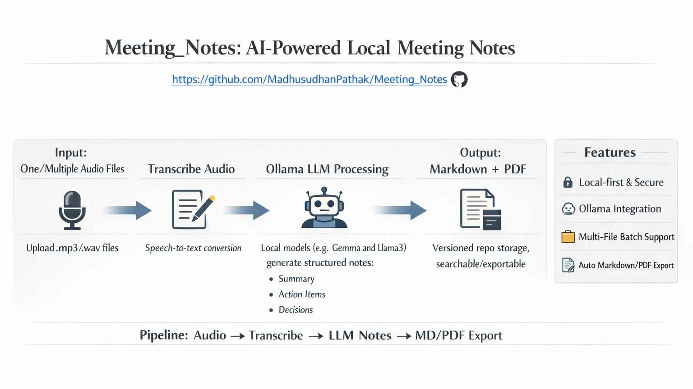

# Local Meeting Notes Generator

A Windows desktop application that turns meeting recordings into transcripts and structured meeting notes, entirely on your own machine. Audio is transcribed with [Whisper.cpp](https://github.com/Const-me/Whisper) and notes are written by a local model served by [Ollama](https://ollama.ai). Nothing is sent to the cloud.

**Video introduction and tutorial:** <https://youtu.be/WZOufhzwrFU>

## Philosophy

This project promotes the use of local, distilled Small Language Models (SLMs) instead of reaching for online Large Language Models (LLMs) for everyday tasks such as writing meeting notes. Keeping everything local is better for privacy, security, and the environment, and sends a positive signal to the AI market. It works well on a system with 16 GB RAM, a good CPU, and a decent GPU running any capable Ollama model. I used this pipeline for about six months and received enough good feedback to package it as a single program.



## Table of Contents

- [Features](#features)
- [Prerequisites](#prerequisites)
- [Installation](#installation)
- [Usage](#usage)
- [Architecture](#architecture)
- [Development](#development)
- [Troubleshooting](#troubleshooting)
- [License](#license)

## Features

- **Local transcription** with Whisper.cpp; audio never leaves your machine.
- **AI meeting notes** generated by any model installed in Ollama.
- **Transcription-only mode** that works without Ollama.
- **Batch processing** of multiple audio files in one run.
- **Three outputs per recording**: transcript (`.txt`), notes (`.md`), and formatted notes (`.pdf`).
- **Selectable models and prompts**: pick the Whisper model, Ollama model, and system prompt from dropdowns.
- **Supported audio formats**: MP3, WAV, M4A, FLAC, AAC, OGG.

## Prerequisites

- Windows (Whisper.cpp is used through `Whisper.exe` / `Whisper.dll`)
- Python 3.8 or newer
- [Ollama](https://ollama.ai), only required for note generation
- A Whisper model file (`.bin`), for example from [Hugging Face](https://huggingface.co/ggerganov/whisper.cpp/tree/main)

## Installation

1. Clone the repository:

   ```bash
   git clone https://github.com/MadhusudhanPathak/Meeting_Notes.git
   cd Meeting_Notes
   ```

2. Install the Python dependencies:

   ```bash
   pip install -r requirements.txt
   ```

3. Make sure `Whisper.exe` and `Whisper.dll` are in the project root (next to `main.py`). They ship with this repository; newer builds are available from [Const-me/Whisper](https://github.com/Const-me/Whisper).
4. Put at least one Whisper model (`.bin`) in the `input/` folder.
5. For note generation, install Ollama and pull a model:

   ```bash
   ollama pull llama2
   ```

6. Add one or more system prompts as `.txt` files in the `input/` folder (for example `input/Professional_Prompt.txt`). Each file holds the instructions the model follows when writing notes.

The `input/` and `output/` folders are created automatically on first launch. The expected layout is:

```text
Meeting_Notes/
├── Whisper.exe
├── Whisper.dll
├── input/
│   ├── *.bin        Whisper model(s)
│   └── *.txt        system prompt(s)
└── output/          generated transcripts and notes
```

## Usage

Start the application:

```bash
python main.py
```

Or double-click **`Meeting Notes.bat`**. The batch file installs Python with `winget` if it is missing, ensures `pip` is available, installs the packages from `requirements.txt` when needed, and then launches the app.

On startup the app checks its dependencies and reports the result in the log panel. Then:

1. Click **Select Audio File** for one recording, or **Select Multiple Files** for a batch.
2. Choose a **Transcription Model** (`.bin`).
3. Choose what to produce:
   - **Transcribe Audio**: writes only the transcript. Ollama is not needed.
   - **Generate Meeting Notes**: choose an **Ollama Model** and **System Prompt** first. Writes the transcript, Markdown notes, and PDF notes.
4. Follow progress in the progress bar and log panel.

Results are saved to `output/` with a timestamp, for example:

```text
output/standup_2024-05-14_10-30-00_transcript.txt
output/standup_2024-05-14_10-30-00_notes.md
output/standup_2024-05-14_10-30-00_notes.pdf
```

In batch mode files are processed one after another. If one file fails, the error is logged and the batch continues with the next file.

## Architecture

```text
main.py                        Entry point
meeting_notes/
├── app.py                     Qt application bootstrap
├── config.py                  Paths, dependency discovery and validation
├── core/                      Business logic (no Qt)
│   ├── transcriber.py         Whisper.cpp wrapper
│   └── note_generator.py      Ollama API client
├── export/                    Output persistence
│   ├── writer.py              Output file naming and writing
│   └── pdf.py                 Markdown → PDF rendering (reportlab)
└── ui/                        Presentation layer (PyQt5)
    ├── main_window.py         Main window and job orchestration
    ├── workers.py             Background threads for long-running jobs
    └── styles.py              Qt style sheets
assets/                        Application icon and documentation images
tests/                         Unit tests (unittest)
```

Processing flow:

```text
MainWindow ──starts──▶ Worker thread ──▶ AudioTranscriber (Whisper.exe)
                                    └──▶ NoteGenerator (Ollama HTTP API)
           ◀─result──
MainWindow ──saves──▶ export.writer ──▶ output/*.txt, *.md, *.pdf
```

`core` and `export` have no dependency on Qt and can be used or tested on their own. See [AGENTS.md](AGENTS.md) for each component's responsibilities and boundaries.

## Development

Run the test suite from the project root:

```bash
python -m unittest discover -s tests -t .
```

To build a standalone Windows executable with [PyInstaller](https://pyinstaller.org):

```bash
pyinstaller main.spec
```

## Troubleshooting

| Message | Fix |
| --- | --- |
| `Whisper.exe not found` / `Whisper.dll not found` | Place both files in the project root, next to `main.py`. |
| `No .bin model file found` | Download a model from [Hugging Face](https://huggingface.co/ggerganov/whisper.cpp/tree/main) into `input/`. |
| `No .txt system prompt file found` | Create a `.txt` file with your prompt in `input/`. Transcription still works without one. |
| `Cannot connect to Ollama` | Install Ollama and make sure it is running (`ollama serve`). |
| `No Ollama models found` | Pull a model, for example `ollama pull llama2`. |
| `Selected file is not a supported audio format` | Use MP3, WAV, M4A, FLAC, AAC, or OGG. |

Detailed error messages always appear in the log panel inside the application. If the problem persists, open an issue on the repository.

## License

This project is licensed under the MIT License.
